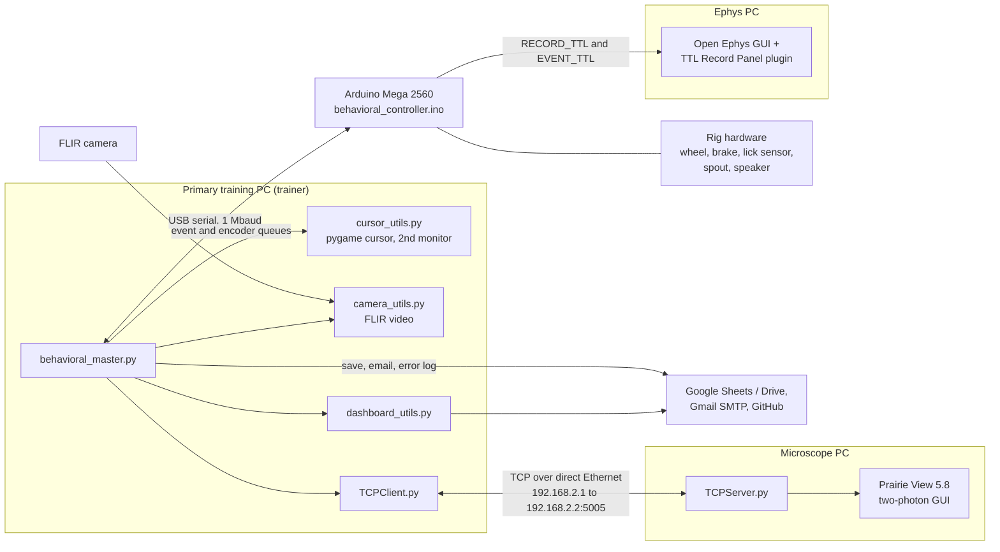

# Behavioral Training System — README

Software and firmware for a rodent behavioral-training rig with optional behavior-camera video,
two-photon imaging (Bruker / Prairie View), and electrophysiology (Open Ephys). The system spans
**three computers and one microcontroller**:

| Part | Role |
|---|---|
| Primary training PC | Where the trainer runs a session (`behavioral_master.py` and helpers); talks to everything else |
| Arduino Mega 2560 | Real-time trial logic, hardware I/O, and TTL outputs (`behavioral_controller.ino`) |
| Microscope PC | Runs Prairie View; `TCPServer.py` starts/stops imaging on command |
| Ephys PC | Runs Open Ephys with the custom **TTL Record Panel** plugin |

This README is written to give a person (or a new chat session) full context on the entire
architecture: how the pieces connect, what each one does, how a session unfolds, and where the
data ends up. Most of the code is Python on the primary training PC, so the component reference
(§9 onward) is weighted toward `behavioral_master.py`.

Upload this README together with `behavioral_master.py` to give a new chat session full context
on how the system works, even without the other source files present.

---

## Contents
- [1. System Overview](#1-system-overview)
- [2. System Architecture](#2-system-architecture)
- [3. Repository Layout](#3-repository-layout)
- [4. Session Lifecycle (End to End)](#4-session-lifecycle-end-to-end)
- [5. Training Phases](#5-training-phases)
- [6. Synchronization and Timestamps](#6-synchronization-and-timestamps)
- [7. Setup and Running](#7-setup-and-running)
- [8. Arduino Firmware (`behavioral_controller.ino`)](#8-arduino-firmware-behavioral_controllerino)
- [9. `behavioral_master.py` — Architecture](#9-behavioral_masterpy--architecture)
- [10. Program Flow](#10-program-flow)
- [11. `cursor_utils.py` — On-Screen Visual Feedback Task](#11-cursor_utilspy--on-screen-visual-feedback-task)
- [12. `dashboard_utils.py` — Shared Status Dashboard](#12-dashboard_utilspy--shared-status-dashboard)
- [13. `TCPClient.py` — Two-Photon Imaging (Prairie View) Client](#13-tcpclientpy--two-photon-imaging-prairie-view-client)
- [14. `camera_utils.py` — Behavior-Camera Video](#14-camera_utilspy--behavior-camera-video)
- [15. `TCPServer.py` — Microscope-PC Server (Prairie View Automation)](#15-tcpserverpy--microscope-pc-server-prairie-view-automation)
- [16. TTL Record Panel (Open Ephys Plugin) and the Arduino TTL Lines](#16-ttl-record-panel-open-ephys-plugin-and-the-arduino-ttl-lines)
- [17. Launcher (`run.bat` / `launcher.ps1`)](#17-launcher-runbat--launcherps1)
- [18. Data Outputs and Storage Layout](#18-data-outputs-and-storage-layout)
- [19. Notable Cross-Cutting Details and Known Quirks](#19-notable-cross-cutting-details-and-known-quirks)

---

## 1. System Overview

**What a session is.** A trainer launches `run.bat` on the primary training PC, answers a few
prompts (animal, training phase, which optional recordings are active), and the session then runs
by itself, typically for 20–30 minutes (length depends on phase). The Arduino runs the trials in real time
— cue, wheel task, reward — and reports every event to the PC over serial. The PC timestamps and
logs everything, mirrors the wheel on a visual "cursor" display, and (optionally) records
per-trial video, triggers per-trial two-photon imaging, and emits sync pulses to the
electrophysiology system. When the session ends, the data is saved to per-animal Google Sheets
workbooks, a status dashboard is updated, and a summary email is sent.

**Rig hardware controlled by the Arduino** (via helper classes in the sketch folder): a wheel
(rotary encoder) with an engageable/releasable **brake**, a capacitive **lick sensor**, a reward
**spout** (pulsed valve), a **speaker** for cue/hit/miss tones, and a `POWER_EN` output (pin 7)
that is raised before the hardware is initialized and dropped at cleanup.

**The trial in one sentence.** In wheel phases, a cue starts a trial of up to 30 s in which the
animal must rotate the wheel past a threshold (in degrees) toward the target side; reaching it is
a **hit** (tone + reward), not reaching it is a **miss** (tone, no reward); phases 0–1 are
earlier training stages without the wheel requirement (see §5).

**Optional modalities** (each chosen per session by the trainer):
- **Video** — FLIR camera, one `.mp4` per trial (§14).
- **Imaging** — Prairie View two-photon, started/stopped per trial or over a fixed window (§13, §15).
- **Ephys** — Open Ephys recording gated by a TTL line, with behavioral events encoded as TTL
  pulse trains (§16).

---

## 2. System Architecture

### 2.1 Block diagram

### 2.2 Links between the parts

| Link | Medium | Details |
|---|---|---|
| Training PC ↔ Arduino | USB serial, 1,000,000 baud | Newline-terminated ASCII. PC → Arduino commands are each acknowledged with a bare `A`; the Arduino streams `[EVT]`, `[ENC]`, and `[RAW]` lines back (§8.2). |
| Training PC ↔ Microscope PC | Direct Ethernet cable, TCP | Client bound to `192.168.2.1`, server at `192.168.2.2:5005`. Line commands `CONFIG`/`START`/`STOP`/`FINISH`, each answered `OK` (§13, §15). |
| Arduino → Ephys PC | TTL wires | `RECORD_TTL` (recording gate) and `EVENT_TTL` (pulse-count event trains) into the acquisition hardware read by Open Ephys; the plugin's default lines are 5 and 6 (1-based). Pin wiring itself isn't in the code (§16). |
| Training PC ↔ FLIR camera | USB (Spinnaker/PySpin) | Frames are written to disk on the training PC (§14). |
| Training PC → cloud | Internet | Google Sheets/Drive (service account), Gmail SMTP (`smtp.gmail.com:587`), GitHub (error-log push), NTP (UDP 123). |

Imaging start/stop reaches the microscope two ways: the PC tells `TCPServer.py` (which clicks
the Prairie View GUI), and — only in ephys sessions — the Arduino also marks the same moments in
the ephys recording with `img_start`/`img_stop` TTL pulse trains.

### 2.3 Responsibilities by computer

| Computer | Runs | Notes |
|---|---|---|
| Primary training PC | `behavioral_master.py`, `cursor_utils.py`, `camera_utils.py`, `dashboard_utils.py`, `TCPClient.py`, `run.bat`/`launcher.ps1` | Connected by USB to the Arduino and by a direct Ethernet cable to the microscope PC. The only machine the trainer interacts with. |
| Arduino Mega 2560 | `behavioral_controller.ino` | Flashed by the launcher on every launch. The Uno is also supported by the firmware and launcher. |
| Microscope PC | `TCPServer.py` | Must have Prairie View 5.8 open before the server starts. |
| Ephys PC | Open Ephys GUI with `ttl-record-panel.dll` | The DLL is built from `OpenEphysLib.cpp`, `TTLRecordPanel.h/.cpp`, `TTLRecordPanelEditor.h/.cpp`. |

### 2.4 Division of labor
The Arduino owns everything with real-time requirements (trial timing, wheel/brake/spout/tone,
TTL pulses) and knows nothing about wall-clock time. The training PC owns orchestration: prompts,
configuration, timestamps, adaptive difficulty, the cursor display, video, imaging control, data
storage, notifications, and error reporting. The microscope and ephys PCs are passive
endpoints: one executes START/STOP clicks, the other decodes TTL.

---

## 3. Repository Layout

### 3.1 File map

| File | Runs on | Role |
|---|---|---|
| `run.bat`, `launcher.ps1` | Training PC | Setup/launch: Python venv, dependencies, Arduino compile/upload, then `behavioral_master` (§17). |
| `behavioral_master.py` | Training PC | Main entry point: prompts, serial protocol, event loop, adaptive difficulty, saving (§9–§10). |
| `cursor_utils.py` | Training PC | `pygame` cursor widget mirroring wheel position during wheel phases (§11). |
| `camera_utils.py` | Training PC | `FLIRCamera`: per-trial `.mp4` video plus `metadata.xml` (§14). |
| `dashboard_utils.py` | Training PC | Google Sheets status dashboard, recent-session log, notifications (§12). |
| `TCPClient.py` | Training PC | `PrairieClient`: TCP client for imaging start/stop (§13). |
| `behavioral_controller.ino` | Arduino | Real-time trial state machine, hardware I/O, TTL outputs (§8). Lives in a `behavioral_controller/` sketch folder with a `sketch.yaml`. |
| `TCPServer.py` | Microscope PC | TCP server that drives Prairie View via UI automation (§15). |
| `OpenEphysLib.cpp`, `TTLRecordPanel.h/.cpp`, `TTLRecordPanelEditor.h/.cpp` → `ttl-record-panel.dll` | Ephys PC | Open Ephys plugin "TTL Record Panel" (§16). |

### 3.2 Runtime files, folders, and settings (primary training PC)
- `.env` (same directory as the script) — environment variables such as `BRAKE_ENGAGE_MS`,
  `BRAKE_RELEASE_MS`, `SPOUT_PULSE_MS`, `CLIENT_ID`, `DASHBOARD_ID`, `SMTP_USERNAME`,
  `SMTP_PASSWORD`, `SMTP_TO_ADDR`, `GITHUB_TOKEN`, per-cohort `<COHORT>_ID` Google Sheets
  workbook IDs, optionally `NTP_SERVER` (defaults to `pool.ntp.org`), and optionally
  `GOOGLE_SERVICE_ACCOUNT_JSON`.
- `credentials.json` — Google service-account credentials for the Sheets/Drive APIs.
- `animal_map.json` — a dict mapping underscore-joined cohort keys (e.g. `"M1_M2_M3"`) to a
  cohort name, used to look up which workbook an animal's data belongs to.
- `errors.log` — local append-only error log, optionally pushed to a GitHub repo
  (`GonzalesLabVU/Behavior-BCI`, `pc/config/errors.log`) if `GITHUB_TOKEN` is set.
- `backup/` — per-session incremental JSON backup files (see `SaveInterface`/`BackupWriter`),
  created at setup and deleted after a successful save.
- `raw_cap_Animal=<id>_Phase=<phase>_<MM-DD-YYYY>.json` — local raw capacitive-sensor export
  written next to the script by `SaveInterface.save_raw()` (only if raw data exists).
- `D:\Behavioral\DeepLabCut\<YYYY-MM-DD>\Animal <id> - Phase <phase>\` — video output folder
  (`VIDEO_BASE_DIR`) used when camera recording is enabled.
- Launcher inputs (see §17): `requirements.txt`, a `behavioral_controller/` sketch folder
  containing `behavioral_controller.ino` and `sketch.yaml`, and (for video) a
  `spinnaker_python-*.whl` PySpin wheel matching Python 3.12.

---

## 4. Session Lifecycle (End to End)

1. **Launch.** The trainer runs `run.bat`. `launcher.ps1` prepares the Python environment,
   compiles and uploads the Arduino sketch, and starts `python -m behavioral_master` (§17).
   If imaging is planned, `TCPServer.py` must already be running on the microscope PC.
2. **Prompts** (`setup()`, §10.1): optional spout flush (the Arduino flushes and reboots, and the program exits
   and must be restarted), animal ID (blank = `DEV`), training phase, target side (phases 4–5), video?,
   imaging? (plus start/stop minutes in phase 2), ephys?
3. **Initialization.** NTP clock sync; serial config handshake with the Arduino (brake/spout
   timings from `.env`, wheel threshold, side, reverse, phase, ephys flag); incremental backup
   file created; Prairie View connection and `CONFIG` (if imaging); FLIR camera configured (if
   video); cursor display started (phases ≥ 4); first trial's config sent; ephys recording
   started via `R1` (if ephys); finally `start 1` begins the session and the dashboard shows
   `running`.
4. **Trial loop** (repeats until the session timer expires). The Arduino runs the trial state
   machine and emits events. For each event the PC logs it with an NTP-corrected timestamp and
   fans it out: cursor, camera, imaging, backup, console table, dashboard, and next-trial
   difficulty. See the event table below.
5. **End of session.** Normally the Arduino's session timer expires and it sends `S`. The trainer
   can abort with Ctrl-C, Escape, or by closing the cursor window; the PC then sends `E` and
   waits for `S`. Either way the PC stops ephys, stops imaging, closes the camera and cursor,
   and stamps `t_stop`/`duration_sec`.
6. **Post-session** (`__main__` driver, §10.3): imaging timestamps are fetched from the
   microscope PC (`FINISH`); the trainer confirms saving and resolves any same-day duplicate;
   raw capacitive data is exported locally; the session is written to Google Sheets (the
   local backup file is deleted on success, kept on failure); the dashboard's Recent Sessions log
   is updated and the rig is marked idle; a summary email is sent (non-`DEV` animals).

### 4.1 Event vocabulary and who consumes it

| Event | Sent by the firmware when | Python handling | TTL pulses (§6.2) |
|---|---|---|---|
| `cue` | A trial's cue begins (a tone in phases 3+) | Logged; cursor arms; video starts; first-trial imaging start; queued next-trial config is sent | 2 |
| `trial_start` | Phases 1–2, in place of `cue` | Same as `cue` | 0 |
| `r_cue` | Re-cue tone after wheel inactivity (phases ≥ 4) | Logged only | 2 |
| `lick` | Each new lick-sensor touch | Mirrored into `raw.evt` only (not the Event sheet) | 1 |
| `hit` | Wheel threshold reached (phase 0: trial window elapses; phase 1: after a lick or timeout) | Logged; per-trial imaging stop/restart; stats and dashboard performance; calibration; next-trial config queued; cursor freezes | 3 |
| `miss` | Threshold missed or trial timed out | Same as `hit` | 3 |
| `trial_stop` | End of the hit/miss feedback period (phases 1+) | Logged; backup slice written; video stops | 0 |
| `[ENC] <deg>` | Wheel displacement milestones during trials (phases 2+) | Appended to the encoder log; drives the cursor | — |
| `[RAW] <n>` | Raw lick-sensor samples (only if firmware `RAW_FLAG` is on) | Raw capacitive log | — |
| `setK <K>` | *(synthetic, created by Python)* calibration result | Logged to the Event sheet | — |

---

## 5. Training Phases

Phase configuration is split between the firmware (`applyPhaseDefaults` and the per-phase state
machines) and Python (`PHASE_CONFIG`, thresholds in degrees).

| Phase | Name / purpose | Wheel threshold | Default side | Firmware behavior | Session / trial / delay |
|---|---|---|---|---|---|
| 0 | No wheel | — | — | Brake stays engaged. `cue` event (no tone) → 30 s window monitoring licks → `hit` event → delay. No tone, wheel, or reward pulse in this phase's code. | 20 min / 30 s / 3 s |
| 1 | No wheel, lick-triggered | — | — | `trial_start`; a lick (or the 5 s timeout) → `hit` with a reward pulse halfway through the 1 s hit period → `trial_stop` → delay. | 1 min* / 5 s / 3 s |
| 2 | Wheel association | 15° | B | Brake released all session. No tones. Wheel reaching threshold → `hit` + reward; miss or timeout → `miss`. | 20 min / 30 s / none |
| 3 | Tone association | 15° | B | Brake released. Cue tone (1 s, licks logged), then wheel trial. Hit tone + immediate reward; miss tone. | 20 min / 30 s / 1 s |
| 4 | Easy wheel | 15° | L (prompted L/R) | Cue tone, then brake released for the trial. Brake re-engaged on hit/miss; hit tone with reward half-way through the 1 s hit period. Inactivity re-cue. | 30 min / 30 s / 3 s |
| 5 | Normal wheel | 30° | L (prompted L/R) | As phase 4; easy/normal trial mix is adaptive. | 30 min / 30 s / 3 s |
| 6 | Harder wheel | 60° | L | As phase 5. | 30 min / 30 s / 3 s |
| 7 | Hardest wheel | 90° | L | As phase 5. | 30 min / 30 s / 3 s |

\*Phase 1's firmware session length is currently `MINUTES(1)` (the 10-minute value is commented
out).

Notes:
- **Side.** `B` = both targets, `L`/`R` = one side. The cursor display draws the matching
  target(s) (§11).
- **Easy vs. normal trials.** An easy trial uses the 15° easy threshold; a normal trial uses
  the phase threshold. Phases below 5 are always easy; from phase 5 up the mix is adaptive
  (§9.5).
- **Cursor display** runs only in phases ≥ 4.
- **Inactivity re-cue** (phases ≥ 4): after the first 5 s of a trial, if the wheel has moved less
  than 5° over a 5 s window (and more than 1 s of trial time remains), the cue tone replays for
  1 s and `r_cue` is sent; the check then restarts.

---

## 6. Synchronization and Timestamps

### 6.1 Clocks
- **Behavioral and encoder events.** The Arduino has no wall clock. The PC's serial reader
  stamps each line on arrival with `_get_ts()`, an `HH:MM:SS.mmm` string from the local clock
  plus an NTP offset. `setup()` measures the offset once (`_sync_ntp_offset()`, server from
  `NTP_SERVER`, default `pool.ntp.org`) and starts a daemon thread that re-syncs every 10 minutes;
  if a sync fails it prints a warning and keeps the last offset (or the plain local clock).
- **Video.** `_get_ts` is injected into `FLIRCamera`, so frame timestamps share that clock.
- **Imaging.** Start/stop timestamps are stamped by `TCPServer.py` with the microscope PC's own
  system clock (`datetime.now()`), not the NTP-corrected offset.
- **Ephys.** Open Ephys timestamps are in sample numbers of its own acquisition stream; the TTL
  pulse trains below are the bridge to the behavioral timeline.

### 6.2 TTL encoding (Arduino → Open Ephys)
- **`RECORD_TTL`** (Mega pin 22, Uno pin 10): driven HIGH/LOW by the PC's `R1`/`R2` commands
  (ephys start/stop) and forced LOW at cleanup. The plugin starts/stops recording on its edges.
- **`EVENT_TTL`** (Mega pin 23, Uno pin 11): each event is a train of 11.111 ms pulses with
  11.111 ms gaps, followed by a 40 ms train gap. The pulse count identifies the event:

| Pulses | Event |
|---|---|
| 1 | `lick` |
| 2 | `cue` (and `r_cue`) |
| 3 | `hit` (and `miss`) |
| 4 | `img_start` |
| 5 | `img_stop` |

`trial_start` and `trial_stop` send no pulses, so hit vs. miss and cue vs. re-cue can't be told
apart from the TTL record alone. Pulse trains are only emitted when the session's `ephys` flag
is 1, which also applies to the imaging marks.

### 6.3 Imaging synchronization
Per-trial imaging (phases other than 2) starts with the first trial's cue; after every hit/miss
it is stopped at +1 s and restarted at +3 s. The PC schedules the Prairie command and the
matching TTL command together so they land at roughly the same moment. Phase 2 instead uses a
single continuous imaging window chosen by the trainer (§10.2).

---

## 7. Setup and Running

### 7.1 Primary training PC
**Prerequisites.** Windows with PowerShell 5.1+, the Python `py` launcher (the launcher can
install Python 3.12 through `winget`), and the Arduino plugged in by USB. The project folder
needs the files listed in §3.2 (`.env`, `credentials.json`, `animal_map.json`,
`requirements.txt`, the `behavioral_controller/` sketch folder with its `sketch.yaml`, and
optionally the PySpin wheel for video). Then run **`run.bat`**: it handles everything else (§17).
The training PC's Ethernet adapter must be assigned `192.168.2.1`.

### 7.2 Microscope PC
1. Install Python with `pyautogui`, `pynput`, and `mss` (without them the server runs
   network-only and performs no GUI actions), and give the Ethernet adapter the address
   `192.168.2.2`.
2. Open Prairie View 5.8 (the window title must match `Prairie View 5.8`) and leave its layout
   untouched — the click targets are fixed pixel offsets (§15).
3. Run `python TCPServer.py` and answer **N** to the development-mode prompt. Start it before
   the training session; it serves one client and exits after the final `FINISH`.

### 7.3 Ephys PC
1. Install `ttl-record-panel.dll` into Open Ephys per its plugin-installation procedure (rebuild
   it from the five source files if the GUI/plugin API version changes).
2. Add **TTL Record Panel** to the signal chain after the source that provides the TTL events,
   set `record_line`/`event_line` to match the Arduino wiring (defaults 5 and 6), and use Binary
   recording. Acquisition must be running for TTL events to reach the plugin.

### 7.4 Per session
Start `TCPServer.py` (if imaging) and Open Ephys (if ephys), then run `run.bat` on the training
PC and follow the prompts.

---

## 8. Arduino Firmware (`behavioral_controller.ino`)

**Platform.** Arduino Mega 2560 (the Uno is supported through `#if` blocks, with TTL pins 10/11
instead of 22/23); serial at 1,000,000 baud. The sketch uses helper classes from headers in its
own folder — `Wheel`, `Brake`, `Lick`, `Speaker`, `Spout`, `Logger`, `Timer` — whose internals
aren't covered here. Other constants: `POWER_EN` = pin 7, `SEED_PIN` = A0 (random seed),
`RAW_FLAG` = `false`, `easy_threshold` = 15°, tone length 1 s, trial timeout 30 s.

### 8.1 Control structure
A cooperative single loop. Each `loop()` call runs `drainSerial()` and `brake.update()`, then
either the phase function for the configured phase (`SessionState::MAIN`) or the cleanup
routine (`SessionState::CLEANUP`). Within a phase function, a `PhaseState` machine
(`IDLE → CUE → TRIAL → HIT/MISS → DELAY`) advances using `Timer` objects. There is no wall-clock
time on the Arduino: it only reports events, and the PC timestamps them.

### 8.2 Serial protocol

**PC → Arduino** (newline-terminated; every accepted line is answered with a bare `A`):

| Line | Meaning |
|---|---|
| `flush 0` / `flush 1` | First command after boot. `1` flushes the spout, prints `R`, and reboots via watchdog (the PC then exits and the program must be restarted). |
| `engage <ms>`, `release <ms>`, `pulse <ms>` | Brake engage/release durations and spout pulse length |
| `threshold <deg>`, `side L`/`R`/`B`, `reverse 0`/`1` | Wheel configuration |
| `phase <n>`, `ephys 0`/`1` | Training phase and whether TTL pulse trains are enabled |
| `<trial_n> <easy: 0/1> [side]` | Trial config. Required at handshake for phases other than 0/1; resent before each later trial in phases ≥ 4 |
| `start 1` | Begin the session (ends the pre-start command loop) |
| `R1` / `R2` | Drive `RECORD_TTL` HIGH / LOW |
| `img_start` / `img_stop` | Emit the 4- / 5-pulse event train (only if `ephys` is 1) |
| `E` | Abort: go to cleanup |
| `H` / `M` | Force a hit/miss during a trial (accepted by the firmware; not used by the Python code) |

**Arduino → PC:** `A` (ack), `[EVT] <name>`, `[ENC] <degrees>`, `[RAW] <value>`, `R` (restart
after a flush), `S` (session ended; cleanup finished).

### 8.3 Boot sequence
`setup()` waits for `flush`; if flushing, it does so and reboots. Otherwise it waits for the
config handshake (all of `engage`, `release`, `pulse`, `threshold`, `side`, `reverse`, `phase`,
`ephys`, plus a trial config where required), applies the phase's timing defaults, raises
`POWER_EN`, initializes brake (engaged), speaker, spout (with five priming pulses), lick sensor,
and wheel, and then accepts `R1`/`R2`/`img_*` until `start 1` arrives.

### 8.4 Trial mechanics (phases ≥ 2)
- `wheel.reset(easy, side)` at trial start; `wheel.update()` while running. The trial ends in a
  **hit** when `thresholdReached()`, or a **miss** when the wheel class reports `thresholdMissed()`
  or the 30 s timer expires.
- Displacement is reported as `[ENC]` milestone samples at ≈0.5° steps.
- **Hit:** `hit` event (phases ≥ 3 also play the hit tone); the reward `spout.pulse()` is fired
  at the start of the hit period in phases 2–3 and halfway through it in phases ≥ 4, where the
  brake is also re-engaged. **Miss:** `miss` event (phases ≥ 3 play the miss tone; phases ≥ 4
  re-engage the brake). Both then wait out the 1 s feedback period, send `trial_stop`, and move
  to the delay.
- Licks are reported as `lick` events whenever the lick sensor is being sampled (during trials
  and most cue, feedback, and delay periods).
- Phases ≥ 4 add the inactivity re-cue described in §5.

### 8.5 Session end and cleanup
When the session timer expires the machine finishes its current delay and enters cleanup (in
phase 1, the trial state pulses the spout and enters cleanup directly). An `E` command does the
same at any time. Cleanup drives both TTL lines LOW, sends `S`, engages the brake, waits 500 ms,
drops `POWER_EN`, and then idles forever; the board must be reset (re-running the launcher
re-flashes it) before another session.

### 8.6 TTL outputs
See §6.2. Pulse trains are generated by blocking `delayMicroseconds` loops (a 5-pulse train blocks the
loop for roughly 140 ms), only when `ephys` is 1.

### 8.7 Raw lick stream
With `RAW_FLAG` compiled as `true`, the loop streams `[RAW]` lick-sensor samples at 100 Hz while
`raw_timer` (5 minutes) is running. It is `false` in the current sketch.

---

## 9. `behavioral_master.py` — Architecture

The script is organized as a set of small **`InterfaceObject`** subclasses, each wrapping one
hardware/API/human boundary, plus a handful of free functions and two data-holding classes
(`SessionData`, `FileLock`). This mirrors an inversion-of-control style: `setup()` and
`main()` take an `interfaces` bundle (a `BehaviorInterfaces` instance) so that any interface
can be swapped out (e.g. for testing) without changing the control flow.

### 9.1 Interface classes

- **`SystemInterface`** — environment/filesystem/hardware glue: loads `.env`, reads
  `animal_map.json`, resolves an animal's Google Sheets workbook ID, finds and opens the
  Arduino's serial port (`_find_arduino_port` looks for "arduino" or "usb serial" in the port
  description), and builds phase-specific config dicts (brake/spout timing, wheel threshold,
  side, reverse flag) by merging `.env` values with the hard-coded `PHASE_CONFIG` table.
- **`ConsoleInterface`** — all trainer-facing console output: session start banner, a
  live-updating trial-status table (trial count, elapsed time, hit/miss block indicators, hit
  rate), a duration summary, and formatted display of any exceptions collected in the global
  `EXC_STACK` at the end of the run.
- **`TrainerInterface`** — all interactive `input()` prompts: whether to flush the reward
  line, animal ID (blank → `"DEV"` debug animal), training phase, target side (phases 4 and 5
  only), whether video/imaging/ephys are active, the continuous-imaging start/stop window
  (phase 2 with imaging only), and confirmation prompts around saving/overwriting.
- **`DashboardInterface`** — pushes `running`/`finished`/`idle` status (plus animal/phase) and
  the live success-rate string (`performance`, updated after every hit/miss) to the shared
  Dashboard sheet via `dashboard_utils.write_fields`. It also appends a "started training"
  line to the Notifications sheet (`record_notification`) at session start and a row to the
  Recent Sessions sheet (`record_session`) at the end. Every write is failure-safe (a
  warning, not a crash) and ignores Ctrl-C while the write is in flight. `notify_idle()`
  (status `idle`, animal/phase cleared) is called from the `__main__` driver after the
  session has been saved/logged.
- **`ExceptionInterface`** — collects exceptions into the module-level `EXC_STACK` (for
  console display), appends formatted tracebacks to the local `errors.log`, and can commit/push
  that log to a GitHub repo using a throwaway shallow clone (via `git` subprocess calls) when
  `GITHUB_TOKEN` is configured.
- **`EmailInterface`** — sends a plain-text/HTML session-summary email (date, start/stop
  time, duration, trial count, hit rate) via Gmail SMTP once a real (non-`DEV`) session
  finishes.
- **`SaveInterface`** — the most complex interface; writes session data into a per-animal
  Google Sheets workbook (see §18.1), plus a local raw capacitive-sensor JSON export
  (`save_raw`). During the session, `start_backup`/`append_backup` stream an incremental
  per-trial JSON backup (`backup/`) through a background `BackupWriter` thread: each trial
  stores only the `SessionData.diff()` slice added since the previous trial, and the file is
  rewritten atomically via a temp file. The backup is deleted after a successful Sheets save
  and kept if the save fails (it replaces the old full-session fallback file).
  `resolve_protocol()` handles same-day duplicate sessions: it prompts to overwrite, or
  auto-overwrites when the earlier session was under 5 minutes and the new one is longer.
  Note: `_build_rows` doesn't currently write a `duration_sec` row to the Metadata sheet, so
  the existing-duration lookup behind that auto-overwrite rule finds nothing for sessions
  saved with the current code.
- **`PrairieInterface`** — wrapper for connecting to / finishing an imaging session via
  `PrairieClient`. `connect()` instantiates the client and sends `CONFIG`; if the connection
  or `CONFIG` fails it prints a warning and the session continues without imaging
  (`meta['imaging_active']` ends up `False`). `finish()` calls `client.finish()` and copies
  the returned start/stop timestamps into `session_data.img`.
- **`CursorInterface`** — starts/updates/stops the `cursor_utils.BCI` visual-feedback task for
  wheel-based phases (phase ≥ 4 only; phases ≤ 3 get `cursor=None`).
- **`BehaviorInterfaces`** — a simple container that instantiates one of each interface above;
  this is the single object passed into `setup()` and `main()`.

### 9.2 `ArduinoLink` — the serial protocol client
This is the Python-side mirror of the Arduino's serial protocol (see §15 for the firmware side
of this exchange).
- Wraps a `pyserial` `Serial` object; if no Arduino was found, `active=False` and every
  send/wait call becomes a harmless no-op (a leftover from the old keyboard-only "DEV" mode;
  `setup()` itself now requires an Arduino).
- Runs a background reader thread (`_reader_loop`) that classifies each incoming line and
  pushes typed messages onto `msg_q`: `"RESTART"` (bare `R`), `"END"` (bare `S`), `"EVT"`
  (`[EVT] ...`), `"ENC"` (`[ENC] ...`), `"RAW"` (`[RAW] ...`), or an `"ERR"` message if the
  reader itself throws. A bare `"A"` line is treated specially — it sets `ack_evt` rather than
  being queued, since it's the handshake acknowledgment.
- `send_and_wait(text)` writes a line and blocks (5 s default timeout per attempt, 2 attempts,
  then `TimeoutError`) until the next
  `"A"` ack arrives — used for every handshake/config command, mirroring the Arduino's
  blocking `waitForHandshake`/`parseStartCommand`/`drainSerial` ack behavior.
- `send(text)` fires and forgets (used for the `"E"` abort command during cleanup).
- `send_after(cmd, delay_s)` spins up a daemon thread to send (and wait-ack) a command after a
  delay — used to schedule imaging start/stop TTL pulses relative to trial outcomes without
  blocking the main loop.
- Convenience wrappers: `send_config()` (sends the full `engage`/`release`/`pulse`/
  `threshold`/`side`/`reverse`/`phase` handshake in order), `send_ephys()`, `send_flush()`
  (also handles the Arduino's forced-reboot-after-flush behavior by raising `SystemExit(0)`
  when it sees the `RESTART` line), `send_start()`, `start_ephys()`/`stop_ephys()` (send `R1`/
  `R2`; `stop_ephys(safe=True)` is idempotent and caches rather than raises failures),
  `start_imaging()`/`stop_imaging()` (send `img_start`/`img_stop`, optionally delayed; the
  Arduino only emits the matching `EVENT_TTL` pulse trains when its `ephys` flag is 1, see §16).

### 9.3 `SessionData` — in-memory session record
A plain data container accumulated throughout the session and eventually serialized:
- `meta` — animal/phase/date, timing, imaging/ephys/video flags, the optional
  continuous-imaging window (`img_start_t`/`img_stop_t`), side override, adaptive-difficulty
  parameters (`K1`, `K2`), internal bookkeeping (`_img_tcp_state`, `_backup_path`), and
  per-trial config log (`trial_config`: trial number, easy/normal, side).
- `evt` — parallel timestamp/value lists of the behavioral events written to the Event sheet
  (`cue` or, in phases 1–2, `trial_start`; `r_cue`; `hit`; `miss`; `trial_stop`; plus
  synthetic `setK <value>` calibration events). `lick` events are not logged here (see
  `raw.evt`).
- `enc` — parallel timestamp/value lists of wheel-displacement milestone samples.
- `img` — lists of imaging start/stop timestamps (filled in from the Prairie client at the
  end of the session).
- `raw` — two sub-logs: `evt` (a raw log of `hit`/`lick` events; this is the only place licks
  are recorded, and it goes to the local backup but is not written to Google Sheets) and
  `cap` (raw capacitive touch-sensor stream, only populated if the Arduino were built with
  `RAW_FLAG` enabled; exported locally by `save_raw`).
- Helper methods: `log_trial_config`, `add_evt`/`add_enc`/`add_raw_cap`/`add_raw_evt`,
  `img_mark_*`/`img_can_start`/`img_can_stop` (a small configured→started→stopped state
  machine that keeps duplicate imaging start/stop commands from being sent), `any_data()`
  (used to decide whether there's anything worth saving), `diff()` (returns only the entries
  added since the last call, for the incremental backup), `to_dict()` (JSON-safe
  serialization; currently not called anywhere), and `is_finished` (both start/stop
  timestamps present).

### 9.4 `FileLock` — distributed Google Sheets lock
Because multiple rigs may write to the same per-cohort workbook, `SaveInterface.save_data()`
takes out a **cooperative distributed lock implemented entirely inside the Google Sheet
itself** (there is no external lock server):
- To acquire, a client creates its own uniquely-named worksheet tab (named after its `owner`
  ID) stamped with a lock "tag" cell and an owner/token/created/expires metadata row, then
  re-scans all sheets for other lock tabs. Among all currently-non-expired lock tabs, the one
  with the earliest `created` timestamp (tie-broken by token, then sheet ID) "wins"; if that's
  the caller's own tab, the lock is acquired. Otherwise the caller deletes its own attempt (if
  any) and polls again after a jittered sleep.
- Expired lock tabs (past their `expires` timestamp) are proactively deleted by whichever
  client notices them first.
- `update()`/`reset()` are called periodically during a long save to refresh/extend the lease
  (`reset_s`/`lease_s` thresholds) and to detect if the lock has been lost (e.g. deleted by
  another client after expiry) — in which case a `RuntimeError` aborts the save.
- `release()` deletes the lock worksheet, retrying a few times with jittered backoff, and
  treats "lock already gone / not owned" as a successful release (idempotent).
- `_get_client_id()` generates a `hostname:pid:random` owner string so concurrent runs (even
  on the same machine) don't collide.

### 9.5 Adaptive trial difficulty
- **`PHASE_CONFIG`** hard-codes wheel-rotation thresholds, target side, and reverse-encoder
  flag per phase (phases 2–7: wheel association → tone association → easy/normal/harder/
  hardest wheel tasks). Phases `"0"` and `"1"` have no wheel requirement and aren't in this
  table (handled as special-cased "no cfg" phases throughout).
- **`_get_easy(phase, trial_n, K)`** decides whether a given trial should use the easy
  (smaller) wheel threshold instead of the phase's normal threshold: always easy below phase
  5; for the first 20 trials, every 5th trial is easy; after that, every `K`-th trial is easy,
  where `K` is adaptively set.
- **`_update_easy_rate(session_data, trial_stack)`** (only used above phase 4, gated by
  `do_calibration`) looks at the animal's hit count over the last `N` trials (initially 20,
  then `N = 4*K`) and sets a new `K` (fewer than 9 hits → more frequent easy trials: `K=3`;
  9–11 hits → `K=5`; 12 or more → `K=7`), logging a synthetic `"setK <K>"` event and locking
  in `calibrated = True` for the rest of the session.
- **`_is_early_exit(...)`** contains a (currently dead — the function returns `False`
  unconditionally on its very first line) more elaborate implementation that would have
  tracked recent trials-per-minute and ended the session early if the animal's trial rate
  dropped too low for too long. Worth knowing about if asked to debug/re-enable early-exit
  behavior, since the "real" logic already exists below the early `return False`.

---

## 10. Program Flow

### 10.1 `setup(interfaces)`
Runs once at program start, before the main event loop:
1. Syncs the NTP clock offset (and starts the background re-sync thread), then finds/opens
   the Arduino serial port (prints a warning if none is found, though setup aborts in step 3
   without one) and wraps it in an `ArduinoLink`.
2. Prompts whether to flush the reward line; if so, sends `flush 1` and lets the Arduino's
   own flush-and-reboot routine run (which raises `SystemExit(0)` back on this side once the
   Arduino signals `RESTART`).
3. Prompts for animal ID (blank defaults to `"DEV"`) and training phase; raises if no Arduino
   was detected (this applies to every animal, including `"DEV"`). `"DEV"` also turns on
   verbose serial logging.
4. For phases `"4"` and `"5"`, additionally prompts for a target side override.
5. Prompts whether video, imaging, and/or ephys are active (plus the continuous-imaging
   start/stop minutes when imaging is on in phase `"2"`).
6. Builds the phase config (brake/spout timings from `.env`, wheel threshold/side/reverse from
   `PHASE_CONFIG`), sends the full config + ephys handshake to the Arduino, creates the
   `SessionData` and starts its incremental backup, connects to Prairie View if imaging is
   active (continuing without imaging on failure), initializes/configures the `FLIRCamera` if
   video is active (continuing without video on failure), and — for phases with a wheel
   component — starts the `CursorInterface` visual feedback task with the first trial's
   easy/side settings.
7. For phase > 1, sends the first trial's config line (`"1 <0|1>"`) to the Arduino.
8. Records the first trial's config, starts ephys TTL if requested, sends the final
   `start 1` handshake command, and notifies the dashboard that the session is `running`.
9. On any exception during setup, caches it, deletes the just-created backup file, best-effort
   closes the camera and the link/serial port, and re-raises (so `__main__` can log/report it
   without crashing ungracefully).

### 10.2 `main(link, session_data, cursor, client, interfaces)`
The live session event loop, driven entirely by messages arriving on `link.msg_q` from the
Arduino reader thread:
- On the very first message, records the session start time and prints the console header.
- **`EVT` messages** are the behavioral event stream and drive almost everything:
  - Every event is also pushed to the global `EVT_QUEUE` so the `cursor_utils` pygame thread
    can react to it (new trial cue, hit/miss) independently of this loop.
  - `cue` (or `trial_start`, which the firmware sends instead of a tone cue in phases 1–2):
    logs the event, starts the next per-trial video file if video is active, and — if imaging
    is active, this is the very first trial, and the phase isn't the continuous-imaging
    phase 2 — sends the initial imaging-start command and starts the TTL sync line together,
    then begins tracking trial number/timing. This is also when any queued next-trial config
    is actually sent to the Arduino (see `hit`/`miss` below).
  - `trial_stop`: logged as an event, queues the trial's new data slice to the incremental
    backup (`append_backup`), and stops the current video file if video is active.
  - `r_cue`: logged as an event (no other side effects here — the re-cue tone is purely an
    Arduino/`cursor_utils` phenomenon).
  - `hit`/`miss`: de-duplicated (an identical outcome arriving less than 100 ms after the
    previous one is ignored); on the real transition it logs the event, and — in every phase
    except the continuous-imaging phase 2 — if imaging is active it schedules (via
    `send_after`) a stop-then-restart of both the Prairie client and the imaging TTL line
    around the inter-trial interval (stop at +1 s, restart at +3 s) so each trial gets its own
    imaging bout. It then updates the rolling trial-outcome window, prints the console
    trial-status row, pushes the running success rate to the dashboard, and — if calibration
    is active — updates the trial-difficulty stack and (once `N` trials have accumulated)
    computes a new `K`. For phase ≥ 4, once calibrated it checks the (currently disabled)
    early-exit condition, and otherwise computes the next trial's easy/side settings and
    queues them as `pending_next_cfg`; the config line is sent to the Arduino (and the
    on-screen cursor's target settings updated to match) when the next `cue`/`trial_start`
    event arrives, not immediately.
  - `hit`/`lick` events are additionally mirrored into `session_data.raw.evt` (the only place
    `lick` events are recorded).
- **`ENC` messages** — parsed as a float wheel-displacement sample, appended to
  `session_data.enc`, and also pushed onto the global `ENC_QUEUE` for the cursor task to
  render live.
- **`RAW` messages** — appended to `session_data.raw.cap` (only produced if the firmware's raw
  capacitive stream is enabled).
- **`END`** (Arduino's `"S"` cleanup marker) — marks ephys as stopped in metadata and breaks
  out of the loop, ending the session normally.
- **`ERR`** — re-raises the underlying exception from the reader thread (or wraps a
  non-exception payload in a `RuntimeError`).
- **Continuous imaging (phase 2 only)** — instead of per-trial imaging bouts, when imaging is
  requested the trainer's start/stop minutes (`img_start_t`/`img_stop_t`) become two daemon
  `Timer`s armed on the first Arduino message. They fire `_img_window_start` /
  `_img_window_stop`, each of which sends the Prairie command and the matching imaging TTL
  command once. The timers are cancelled, and a still-running imaging window is stopped, in
  the `finally` block. `SessionData`'s `_img_tcp_state` guards every start/stop so duplicates
  are skipped.
- On `KeyboardInterrupt`, marks the session aborted, safely stops ephys, and calls `_cleanup`
  (which sends the Arduino an `"E"` abort command and waits, with a timeout, for its `END`
  acknowledgment) before re-raising.
- The `finally` block always stamps `t_stop`/`duration_sec`, safely stops ephys, cancels any
  continuous-imaging timers, stops the Prairie client if imaging is still running, queues one
  last backup slice, notifies the dashboard that the session has finished, and then sleeps
  6 s before restoring the default Ctrl-C handler.

### 10.3 `if __name__ == "__main__":` driver
Wraps `setup()` + `main()` in a top-level try/except/finally that:
- Tracks `animal_id_for_log`/`phase_id_for_log` for error-log context even if setup fails
  early.
- Treats `SystemExit`/`KeyboardInterrupt` as clean exits; caches and displays anything else.
- Always shows a run summary; then finishes the Prairie client (queueing a final `"img"`
  backup slice with the imaging timestamps), stops the cursor task, closes the Arduino link,
  and closes the camera (each independently guarded so one failure doesn't block the other
  cleanup steps; each failure is logged/committed via `ExceptionInterface`).
- If there's no data or it's a `DEV` run, the backup file is simply deleted. Otherwise it
  prompts to confirm saving, resolves the duplicate-session overwrite protocol
  (`SaveInterface.resolve_protocol`), and — if confirmed — saves the raw capacitive data
  locally and the full session to Google Sheets; if the Sheets save fails, a warning is
  printed and the local backup file is kept.
- Records the session's final success rate to the dashboard's Recent Sessions log, marks the
  dashboard `idle`, and — if the session actually finished (`is_finished`) and wasn't the
  `DEV` animal — emails a session summary.
- Finally re-displays any collected exceptions along with a `[Process exited with code N]`
  line. The script itself no longer waits for a keypress; `launcher.ps1` pauses on "Press
  Enter to continue" so a double-clicked window doesn't vanish immediately.

---

## 11. `cursor_utils.py` — On-Screen Visual Feedback Task

Provides a `pygame`-based full-screen (or windowed) "cursor" widget shown on a second monitor
during wheel-based training phases (phase ≥ 4), giving the animal (and trainer) real-time
visual feedback of wheel rotation alongside the physical brake/tone/reward hardware.

- **Module-level shared state**: `TRIAL_CONFIG` (a `(is_easy, alignment)` tuple, guarded by
  `TRIAL_LOCK`) lets the main script update the next trial's difficulty/side from a different
  thread; `ABORT_EVT` lets the cursor thread signal the main script that the trainer closed
  the window or hit Escape/Ctrl-C, which `main()` checks each loop iteration to raise a clean
  `KeyboardInterrupt`.
- **`cursor_fcn(threshold, evt_queue, enc_queue, ...)`** is the actual pygame render loop, run
  in its own thread:
  - Initializes pygame and picks a display/fullscreen mode on first call (or reuses an
    existing surface on subsequent calls within the same process).
  - Consumes `evt_queue` (the same events `behavioral_master.py` pushes to `EVT_QUEUE`): a
    `cue` event resets/arms the cursor for a new trial and adopts the latest `TRIAL_CONFIG`; a
    `hit`/`miss` event (while a trial is active and not already in a delay) freezes the cursor
    at its current position and starts a fixed post-outcome delay before blacking out the
    screen until the next `cue`.
  - While an active, non-delayed trial is running, consumes `enc_queue` (mirroring the wheel
    displacement pushed from `main()`'s `ENC` handling) to update the drawn cursor position,
    scaled so that the phase's easy/normal threshold always maps to a fixed target position on
    screen regardless of the actual threshold magnitude (`gain = target_deg / threshold`), and
    draws left/right/both target boxes depending on the trial's required side.
  - Watches for the window being closed, Escape, or Ctrl-C, in which case it sets `ABORT_EVT`
    and returns `'quit'`; a `stop_evt` (set from `BCI.stop()`) causes it to quit and return
    `'stopped'` instead.
- **`BCI` class** — the thread-lifecycle wrapper `behavioral_master.py` actually uses:
  - `__init__` reads the current phase's config (`bidirectional`, `threshold`) out of the same
    `PHASE_CONFIG` dict used on the main-script side; `enabled` is `False` for phases without
    a config entry (i.e., phases ≤ 3).
  - `start()` launches `cursor_fcn` in a daemon thread if enabled and not already running.
  - `update_config(is_easy, alignment)` updates the shared `TRIAL_CONFIG` under `TRIAL_LOCK`
    for the next `cue` event to pick up.
  - `stop(timeout)` signals `_stop_evt`, posts a synthetic pygame `QUIT` event as a wake-up
    nudge, and joins the render thread.

---

## 12. `dashboard_utils.py` — Shared Status Dashboard

A small, independent Google Sheets writer used for a live multi-rig status dashboard plus its
recent-session and notification logs (distinct from the per-animal data workbooks that
`SaveInterface` writes to).

- Lazily loads `.env` (its own private cache, separate from `behavioral_master.py`'s
  `dotenv`-based loading) and lazily builds/caches a `gspread` client from either
  `credentials.json` or a `GOOGLE_SERVICE_ACCOUNT_JSON` environment variable.
- `CLIENT_START_COLS` maps three fixed client types (`BEHAVIOR`, `IMAGING`, `DEVELOPMENT` —
  with `BEH`/`IMG`/`DEV` shorthand accepted) to fixed starting columns on a single `"Dashboard"`
  worksheet; `FIELD_ROWS` maps `status`/`animal`/`phase`/`performance` to fixed rows.
- `write_fields(client_id, fields, timestamp=None)` — normalizes the client ID, resolves (or
  creates, if missing) the `"Dashboard"` worksheet, and batch-updates a `[timestamp, value]`
  pair into the two-column block for each requested field/row. This is the function
  `DashboardInterface._safe_write()` calls on the `behavioral_master.py` side to report
  `running`/`finished`/`idle` status plus the current animal/phase.

- `log_session(client_id, animal, phase, performance, start_utc=None)` — inserts a row (date,
  platform, animal, phase, performance, local start time) at the top of a `"Recent Sessions"`
  worksheet, creating it with headers if missing; skipped when `performance` is blank.
- `log_notification(message)` — inserts a `[timestamp, message]` row at the top of a
  `"Notifications"` worksheet (also auto-created). `DashboardInterface.notify_start()` uses it
  to announce each session start.

---

## 13. `TCPClient.py` — Two-Photon Imaging (Prairie View) Client

Implements `PrairieClient`, a raw-TCP client that talks to a fixed local-network endpoint
(client bound to `192.168.2.1`, server at `192.168.2.2:5005`), i.e. the primary training PC
talking over a direct Ethernet cable to `TCPServer.py` (§15) on the microscope PC that controls
Prairie View. This is what `PrairieInterface` in `behavioral_master.py` wraps.

- **Connection & wire protocol.** On construction, it opens a `TCP_NODELAY` blocking socket,
  connects immediately (so `PrairieClient()` itself can raise if the imaging rig is
  unreachable — which is why `PrairieInterface.connect()` wraps instantiation in a try/except),
  and wraps the socket in a buffered file object for line-based reads. Every command is a
  single newline-terminated ASCII line (`CONFIG`, `START`, `STOP`, `FINISH`); every reply is a
  single line starting with `OK` (optionally followed by JSON payload data for `FINISH`) or
  anything else, which is treated as failure. `_hexdump`/`_dump` provide optional verbose
  wire-level logging.
- **Single background network thread.** All actual socket I/O happens on one dedicated
  `_net_loop` thread reading off an internal command queue (`_q`); every public method
  (`configure`, `start`, `stop`, `finish`) funnels through `_enqueue()`, which posts a
  `(cmd, want_data, response_queue)` tuple and then blocks (with a timeout) on a private
  one-slot response queue. This serializes all traffic over the single socket regardless of
  which caller/thread invoked the method, which matters because `start_after`/`stop_after`
  fire from separate `threading.Timer` threads.
- **`configure()`** — sends `CONFIG`; returns whether the rig acknowledged.
- **`start(wait_s=None)` / `stop(wait_s=None)`** — send `START`/`STOP`, optionally sleeping
  first (this sleep happens synchronously on the *caller's* thread, not the network thread).
  Each is idempotent/no-op-safe: `start()` no-ops (returns `True`) if already imaging, `stop()`
  no-ops if not currently imaging, and both refuse (`return False`) once `finish()` has been
  called. Internal `_imaging` state tracks which is currently true.
- **`start_after(delay_s)` / `stop_after(delay_s)`** — schedule a `start()`/`stop()` on a
  daemon `threading.Timer` after `delay_s`, cancelling any previously pending timer of the
  same kind first. This is what `behavioral_master.py`'s `link.start_imaging(delay_s=...)` /
  `link.stop_imaging(delay_s=...)` (via `ArduinoLink.send_after`) ultimately compose with —
  note there are actually two independent scheduling mechanisms in play across the whole
  system: `ArduinoLink.send_after` schedules the Arduino TTL command, while
  `PrairieClient.start_after`/`stop_after` independently schedules the imaging-software
  command, and `main()` fires both roughly together so the TTL pulse and the imaging
  start/stop land at (approximately) the same time.
- **`restart_after(stop_delay_s, start_delay_s)`** — a convenience chained scheduler (stop,
  wait, start) that exists but is not currently invoked anywhere in `behavioral_master.py`
  (which instead separately calls `stop_after` and `start_after`/`start` back-to-back).
- **Timer `.join()` patch.** `_patch_join` monkey-patches each `threading.Timer` instance with
  an additional `isr_join(interval=0.2)` method that polls `is_alive()` in a loop rather than
  doing a single blocking join — a defensive pattern presumably intended for use from
  interrupt-sensitive contexts (name suggests "ISR-safe join"), though nothing in the uploaded
  code currently calls `.isr_join()` instead of the normal `.join()`.
- **`finish()`** — cancels any pending timers, then repeatedly sends `FINISH` (which
  `TCPServer.py` answers with one `{start_ts, stop_ts, done}` JSON object per call, walking
  its recorded timestamps in order) until the server signals `done`, accumulating the full
  list of
  imaging start/stop timestamps for the session. Sets `_finished = True`, after which all
  other methods become permanent no-ops. `PrairieInterface.finish()` (on the
  `behavioral_master.py` side) copies `client.start_ts`/`client.stop_ts` into
  `session_data.img` right after calling this.
- **Pending-error propagation.** Because `start_after`/`stop_after`/`restart_after` run on
  background timer threads, any exception they raise can't surface to the caller directly;
  instead `_set_pending_error` stashes the first such exception, and the (currently unused by
  `behavioral_master.py`) `raise_pending_error()` method exists to let a caller poll for and
  re-raise it later on the main thread. Since nothing currently calls
  `raise_pending_error()`, scheduled start/stop failures are effectively silent unless
  `verbose=True` wire logging is enabled — worth knowing if asked to debug why a scheduled
  imaging start/stop silently failed.
- **`disconnect()`** — stops the network thread, closes the read-file and shuts down/closes
  the socket; not currently called anywhere in `behavioral_master.py` (which calls `finish()`
  but never `disconnect()` on the shared `client`), so the socket is left open until process
  exit — only relevant if asked to debug resource cleanup or add explicit disconnect handling.
- **`if __name__ == "__main__":` block** — a standalone smoke-test/demo harness (configure,
  start, a long stop, then loop start/stop) not used by the main behavioral system; useful
  only as a reference for expected command sequencing against the real imaging rig.

---

## 14. `camera_utils.py` — Behavior-Camera Video

`FLIRCamera` records per-trial video from the first FLIR camera found through the Spinnaker SDK
(`PySpin`, which `launcher.ps1` installs from a local wheel). It is created directly in
`setup()` (there is no `InterfaceObject` wrapper) only when the trainer answers "yes" to the
video prompt; if the camera can't be initialized, setup prints a warning and continues without
video (`meta['video_active'] = False`).

- **Output.** Files go to `VIDEO_BASE_DIR / <YYYY-MM-DD> / "Animal <id> - Phase <phase>"`
  (`D:\Behavioral\DeepLabCut` by default), one file per trial named
  `<date>_animal-<id>_phase-<phase>_trial-<n>.mp4`.
- **Configuration (`configure()`).** Full-sensor field of view, 4×4 averaged binning, manual
  exposure (2000 µs) and gain (15), `Mono8` pixels, 30 fps, maximum USB throughput; it then
  does a throwaway `cv2.VideoWriter` open/close to warm up the `avc1` encoder.
- **Recording.** `start()` spawns a daemon acquisition thread that writes frames with
  `cv2.VideoWriter` and logs, per trial, the first/last frame timestamp (via the injected
  `ts_fcn`, i.e. `_get_ts`) and the frame count. `stop()` signals the thread and joins it
  (5 s timeout), re-raising any exception captured on the thread. `behavioral_master.main()`
  calls `start()` on each `cue`/`trial_start` and `stop()` on each `trial_stop`.
- **Metadata.** `close()` (also registered with `atexit`) stops any active recording, writes
  `metadata.xml` into the output folder with the measured `frameRate`, `frameCount`, `tStart`,
  and `tStop` for every trial, and releases the camera.

---

## 15. `TCPServer.py` — Microscope-PC Server (Prairie View Automation)

Runs on the computer that controls the Bruker two-photon microscope and is the other half of
`TCPClient.py`. It binds to `192.168.2.2:5005`, accepts a single client connection, and
executes newline-terminated commands by driving the Prairie View 5.8 GUI through `pyautogui`/
`pynput`/`mss` UI automation (if those imports fail it runs network-only and the GUI actions
are no-ops).

- **Startup.** `main()` looks for a window titled `Prairie View 5.8` (error dialog if it can't
  be found), draws a transparent red border overlay around the monitor holding that window,
  starts the server, and polls every 500 ms; the process exits if Prairie View's window
  disappears. Answering `y` to the "development mode" prompt instead prints the mouse position
  relative to the Prairie View window, for re-calibrating the hard-coded click targets.
- **Commands** (`VALID_CMD`). Each is answered with `OK` (plus a JSON payload for `FINISH`) or
  `ERR`, and is only accepted in the `IDLE` state:
  - `CONFIG` — clicks the T-Series controls and types the period (`0.001`) and duration
    (`35`) values. Repeats are ignored once configured.
  - `START` — increments the server's trial counter, appends a timestamp to `start_ts`, types
    the counter into the iteration field, and clicks the trigger button.
  - `STOP` — appends a timestamp to `stop_ts`, clicks the trigger button again, then closes
    the "Playback Controls" window if it appears.
  - `FINISH` — returns one recorded `{start_ts, stop_ts, done}` entry per call; after the last
    entry it reports `done` and shuts the server down.
- **Fragility.** Click targets are fixed pixel offsets (`PrairieUser.pixel_map`) relative to
  the Prairie View window, so any change to its layout or display scaling requires
  re-calibration. Timestamps use this PC's local clock (`HH:MM:SS.mmm`).

---

## 16. TTL Record Panel (Open Ephys Plugin) and the Arduino TTL Lines

`ttl-record-panel.dll` is built from `OpenEphysLib.cpp`, `TTLRecordPanel.h/.cpp`, and
`TTLRecordPanelEditor.h/.cpp` and loaded into the Open Ephys signal chain on the ephys PC as a
`UTILITY` processor named "TTL Record Panel" (library version 0.1.0). It consumes TTL events
from the Arduino's two digital outputs, `RECORD_TTL` and `EVENT_TTL` (Mega: pins 22/23;
Uno: 10/11).

- **Record gate (`record_line`, default 1-based line 5).** A rising edge calls
  `CoreServices::setRecordingStatus(true)` and a falling edge stops recording. The Python side
  drives this line with `ArduinoLink.start_ephys()`/`stop_ephys()` (`R1`/`R2` → `RECORD_TTL`
  HIGH/LOW); the firmware also forces both lines LOW during cleanup.
- **Event trains (`event_line`, default 6).** The firmware's `sendPulseTrain()` marks each
  event with a number of pulses (11.111 ms high, 11.111 ms gap, then a 40 ms train gap). The
  plugin counts rising edges and decodes a train once the line has been quiet for
  `decode_gap_ms` (default 33 ms). A decoded count `N` is written as a one-sample pulse on the
  plugin's own `"TTL"` channel at line index `N-1` (so `states.npy` shows ±`N`); counts above 8
  are ignored. Pulse counts: 1 = `lick`, 2 = `cue` (or `r_cue`), 3 = `hit` (or `miss`),
  4 = `img_start`, 5 = `img_stop`. `trial_start`/`trial_stop` and all other events send no
  pulses, so hit vs. miss and cue vs. re-cue can't be told apart from the TTL record alone.
- **Only when `ephys` is on.** `sendPulseTrain()` returns immediately unless the session
  config has `ephys 1`, so the event and imaging pulse trains (including those triggered by
  `img_start`/`img_stop`) are only emitted for ephys sessions.
- **Editor/parameters.** Combo boxes for `record_line`/`event_line` (1-based GUI numbering,
  converted from the 0-based `TTLEvent::getLine()`), a `decode_gap_ms` box, and
  `enable_record_control`/`enable_event_decode` checkboxes. A status-bar warning is sent if
  both lines are set to the same number. With Binary recording, decoded events are saved under
  `events/TTL_Record_Panel-<node id>.Rhythm Data/TTL/`.

---

## 17. Launcher (`run.bat` / `launcher.ps1`)

`run.bat` unblocks and runs `launcher.ps1` (PowerShell 5.1+) from its own folder; this is the
normal way to start a session on the primary training PC. Each run:
1. Ensures a Python 3.12 virtual environment (`.venv`), installing Python via `winget` if the
   `py` launcher doesn't have it, then upgrades pip and installs `requirements.txt`.
2. Installs the PySpin wheel (`spinnaker_python-*.whl`, `cp312`/`win_amd64`) if PySpin isn't
   importable (only a warning if it's missing, since video is optional).
3. Ensures `arduino-cli` and the `arduino:avr` core, plus the libraries listed in
   `behavioral_controller/sketch.yaml`.
4. Detects an Arduino Mega 2560 (or Uno) on USB, compiles the `behavioral_controller` sketch
   (auto-installing a missing library header such as `Servo.h` and retrying), and uploads it,
   so the firmware is re-flashed on every launch.
5. Runs `python -m behavioral_master` from the project folder (which is why
   `SCRIPT_DIR = Path.cwd()` finds `.env`, `credentials.json`, `animal_map.json`, and
   `backup/`), then waits for Enter before closing.

---

---

## 18. Data Outputs and Storage Layout

### 18.1 Per-animal Google Sheets workbooks (written by `SaveInterface`)
Workbook ID per cohort (`<COHORT>_ID` in `.env`, looked up through `animal_map.json`). Tabs:
`Event`, `Encoder`, `Imaging`, `Metadata`. Each session occupies a **two-column block** on every
tab: row 1 = date, row 2 = `Animal <id>` | `Phase <n>`, row 3 blank, data from row 4.
- `Event`: `[timestamp, event]` (`cue`/`trial_start`, `r_cue`, `hit`, `miss`, `trial_stop`, `setK <K>`).
- `Encoder`: `[timestamp, displacement]` milestone samples.
- `Imaging`: `[timestamp, "start"|"stop"]` from the microscope PC.
- `Metadata`: key/value rows — `client`, `imaging_active`, `ephys_active`, `K1`, `K2`,
  `easy_trials`, `normal_trials`, `left_targets`, `right_targets`, `both_targets` (lists spill
  into continuation rows with a blank key).
Concurrent writes from multiple rigs are serialized by the Sheets-based `FileLock` (§9.4); its
temporary lock tabs appear and disappear during a save.

### 18.2 Dashboard workbook (`DASHBOARD_ID`, written by `dashboard_utils`)
- `Dashboard`: one column pair per client (`BEHAVIOR` cols 1–2, `IMAGING` 3–4, `DEVELOPMENT` 5–6);
  rows `status`, `animal`, `phase`, `performance`, each as `[timestamp, value]`.
- `Recent Sessions`: newest-first log (date, platform, animal, phase, performance, start time).
- `Notifications`: newest-first `[timestamp, message]` log.

### 18.3 Training PC local files
- `backup/date=<date>_animal=<id>_phase=<n>_id=<rand>.json` — incremental per-trial backup; deleted
  after a successful save, kept after a failed one.
- `raw_cap_Animal=<id>_Phase=<n>_<MM-DD-YYYY>.json` — raw capacitive-sensor export (if any).
- `D:\Behavioral\DeepLabCut\<YYYY-MM-DD>\Animal <id> - Phase <n>\` — per-trial `.mp4` files and
  `metadata.xml` (frame rate, frame count, start/stop timestamps per trial).
- `errors.log` — local error log, optionally pushed to the `GonzalesLabVU/Behavior-BCI` repo at
  `pc/config/errors.log`.

### 18.4 Microscope PC and ephys PC
- Prairie View saves the T-series images itself; these scripts only drive it and record
  start/stop timestamps (returned to the training PC and saved to the `Imaging` tab).
- Open Ephys's Binary recording contains the raw signals and, under
  `events/TTL_Record_Panel-<node id>.Rhythm Data/TTL/`, the decoded behavioral events (see §16).

### 18.5 Email
For completed non-`DEV` sessions, a summary email (date, start/finish times, duration, total
trials, success rate, plus any collected exception stack) is sent through Gmail SMTP.

---

## 19. Notable Cross-Cutting Details and Known Quirks
- `ArduinoLink` still turns every `send*`/`start_ephys`/`start_imaging` call into a no-op when
  its serial port is missing (`active` is `False`), but `setup()` now raises if no Arduino is
  detected (even for the `DEV` animal), so the old keyboard-only "no hardware" dev mode is
  effectively gone. The other optional pieces degrade gracefully instead: a failed Prairie
  connection or camera init just prints a warning and the session continues without
  imaging/video.
- The global `EVT_QUEUE`/`ENC_QUEUE` (defined in `behavioral_master.py` and passed into
  `cursor_utils.BCI`) are the sole communication channel between the main serial-reading
  loop and the independent pygame cursor thread — there's no shared session-state object
  passed directly between them.
- Error handling is deliberately layered and non-fatal wherever possible: almost every cleanup
  step (closing the link, stopping the cursor, finishing Prairie, sending the session email,
  saving data) is wrapped so a failure in one doesn't prevent the others from running, with
  failures instead cached to `EXC_STACK` and optionally persisted to `errors.log`/GitHub via
  `ExceptionInterface`.
- Session data is saved in *pairs of columns* on shared per-cohort Google Sheets workbooks
  (one 2-column block per animal/phase/date, located by matching date/animal/phase header
  text), which is why the `FileLock` distributed-locking mechanism exists — concurrent writes
  from multiple rigs to the same workbook would otherwise race.
- `main()`'s hit/miss handling checks `client.stop_after(...)` and `link.stop_imaging(...)`
  (etc.) return values and raises if either reports failure, but those calls only report
  whether the *scheduling* succeeded, not whether the *scheduled* action itself later
  succeeds — a delayed `PrairieClient` start/stop failure is only recorded via
  `_set_pending_error` and, since `raise_pending_error()` is never polled, will not surface
  as a visible error during the session.

- **Known quirks worth knowing** (observed in the current code, not necessarily bugs):
  - `lick` events never reach `session_data.evt`, so they aren't in the Google Sheets Event tab;
    they exist only in `raw.evt` (local backup).
  - `_build_rows` doesn't write `duration_sec` to the Metadata sheet, so the "auto-overwrite an
    earlier session shorter than 5 minutes" rule in `resolve_protocol()` finds nothing to
    compare against for sessions saved with the current code.
  - Imaging start/stop TTL marks, like all event pulse trains, are emitted only when the
    session's `ephys` flag is 1.
  - Hit/miss and cue/re-cue share pulse counts, so they can't be distinguished in the TTL record.
  - Phase 1's firmware session length is currently 1 minute (10 minutes is commented out).
  - Imaging timestamps come from the microscope PC's local clock rather than the NTP-corrected
    clock used everywhere else on the training PC.
